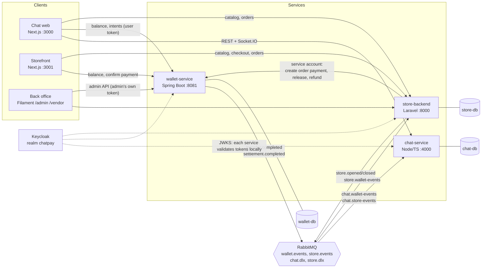
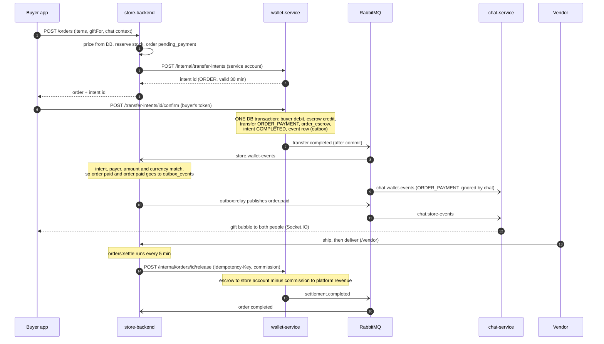
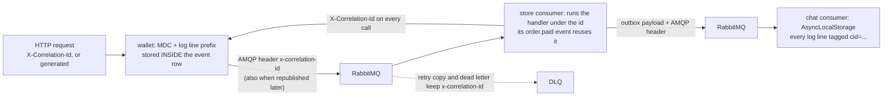
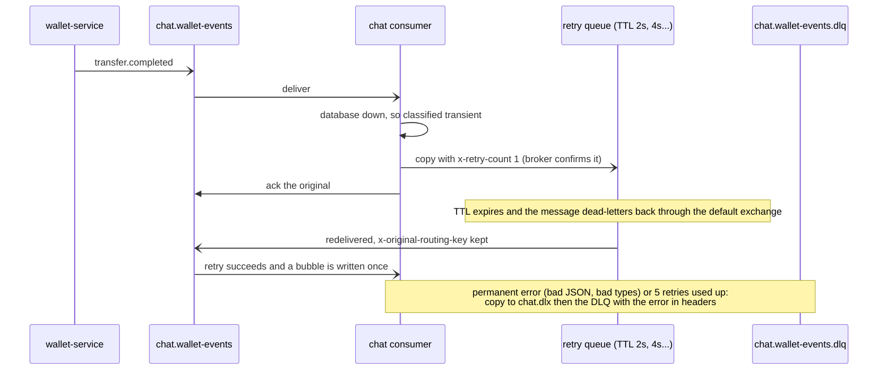

# Chat Pay: product and architecture

What the system does, how its services connect, how events flow, how it is tested, and what is left. Companion documents:
[`events.md`](events.md) (every queue, who sends and listens), [`runbooks/dead-letters.md`](runbooks/dead-letters.md), [`RUNBOOK.md`](RUNBOOK.md) (first run), [`../CHECKLIST.md`](../CHECKLIST.md), [`../contracts/events/README.md`](../contracts/events/README.md).

## 1. What Chat Pay can do today

One Keycloak realm (`chatpay`) gives single sign-on. Each backend owns its own database; only the wallet writes money. Amounts are integers in minor units (GMD, butut).

### Users
| Area | Capabilities |
|---|---|
| **Chat** | 1:1 chats; public and private groups with roles and invites; unread counts, @mentions, typing indicators; live delivery over Socket.IO; a store icon next to store owners |
| **Money in chat** | Send money inside a 1:1 chat (create an intent, review it, confirm). A payment bubble appears for both people. Wallet balance and a statement with running balances. |
| **Shop in chat** | Search and browse hot products, then buy for yourself or as a **gift** for the person you are chatting with. A gift bubble appears for both. |
| **Storefront (:3001)** | Anonymous browsing, a cart per store, checkout, "my orders" (polls every 4s), and a **Sell** page to apply for a store |

### Merchants
- **Apply for a store.** It starts `pending` and invisible; a catalog admin activates it, which announces `store.opened` so the chat shows the icon.
- **Back office (`/vendor`):** manage products and orders, ship, deliver.
- **Payout** happens after delivery plus a return window (default 0 days). The platform commission defaults to 10%; a store can override it.

### Finance and platform admins (`/admin`)
- Catalog and store management with an audit trail of edits; wallet lookup (wallets, transfers, statements).
- **Corrections need two people:** a reversal or adjustment is requested by one admin and approved by a different one.
- A reconciliation report: an empty result means every cached balance equals the sum of its ledger entries.

### Money rules the wallet enforces
- **Double-entry, append-only ledger.** Database triggers refuse updates and deletes; corrections are new entries.
- **Payments are two steps:** create an intent, then confirm it. Confirming twice pays once. A person-to-person intent lives 10 minutes, an order intent 30.
- **Order payments go into escrow, not to the store.** Release (in instalments if wanted) splits escrow between the store and platform revenue; refund returns escrow to the buyer. Each settlement carries an idempotency key.
- **Prices come from the store's database,** never from the client. An order cannot mix stores.
- **Late or mismatched payments:** a payment for an expired order is refunded automatically; a mismatched one goes to `payment_review`.

### Not built yet
Real funding (the only way to add money is the dev top-up), a payment PIN and limits, refund after payout, a cart across several stores in one payment, shipping addresses, a vendor earnings view.

## 2. How the services connect

- **Browsers never talk to RabbitMQ.** They use HTTP, plus Socket.IO for chat.
- **Service to service:** the store calls the wallet with a Keycloak service account (role `wallet-merchant`); admins call the wallet with their own token (role `wallet-admin`).
- **Outbox pattern on both producers.** The wallet writes each event to `event_publication` in the same database transaction as the money movement; after commit Spring Modulith publishes it and marks it complete, and a timer (`OutboxSweeper`, every 30s) republishes any that could not be sent. The store writes to `outbox_events` in the same transaction as the change; `outbox:relay` publishes with broker confirms, then sets `published_at`.
- **Delivery is at-least-once.** Every consumer is idempotent (the chat has unique indexes on transfer and order ids; the store checks the order's status).

### Lifecycle of an order payment (a gift bought from a chat)

Variations: **refund** (`/internal/orders/{id}/refund`) returns escrow to the buyer and `settlement.completed` (REFUND) marks the order refunded. **Expiry:** `orders:expire` (every minute) cancels unpaid orders and restocks; a payment that arrives afterwards is refunded automatically (key `order-{id}-late-refund`). Storefront buyers see `paid` by polling every 4s.

### Correlation ids: one id per story

Every request and message carries an id, so "what happened to this payment?" is one search in all three services' logs.

- **HTTP in:** `X-Correlation-Id` is taken from the request or generated (UUID v4), returned on the response (also on 401/404/500), and bound to the log context (Spring MDC, Laravel `Log::withContext`, Node `AsyncLocalStorage`). Values are limited to `A-Za-z0-9._:-`, 64 characters; anything else is replaced, so a client cannot forge log lines.
- **HTTP out:** the store sends it on every call to the wallet.
- **Events:** the id is stored in the event itself (`correlationId`, part of the contract) so it survives a crash or a delayed republish, and is sent as the AMQP header `x-correlation-id`. A consumer that publishes a follow-up event reuses the id it received.
- **Consumers and dead letters:** both consumers run each message under its id; retry copies and dead letters keep `x-correlation-id`, and `dlq:list` shows it.
- **Check it on the real stack:** `make e2e-correlation`.

## 3. Event contracts (`contracts/events/`)

| Fixture | Exchange / routing key | Producer | Consumers | Payload (all carry `version`, `occurredAt`, `correlationId`) |
|---|---|---|---|---|
| `transfer.completed.p2p` | `wallet.events` / `transfer.completed` | wallet | chat, store | `transferId, intentId, kind=P2P, fromUserId, toUserId, amountMinor, currency, note, referenceType=chat, referenceId` |
| `transfer.completed.order-payment` | same | wallet | chat, store | same fields with `kind=ORDER_PAYMENT, toUserId="store:7", referenceType=order` |
| `settlement.completed.release` | `wallet.events` / `settlement.completed` | wallet | store | `settlementId, orderId, kind=RELEASE, storeId, payerUserId, amountMinor, commissionMinor, currency` |
| `settlement.completed.refund` | same | wallet | store | same fields with `kind=REFUND, commissionMinor=0` |
| `store.opened` | `store.events` / `store.opened` | store | chat | `ownerUserId, storeId, name, slug` (also sent on rename) |
| `store.closed` | `store.events` / `store.closed` | store | chat | `ownerUserId, storeId` |
| `order.paid` | `store.events` / `order.paid` | store | chat | `orderId, storeId, storeName, buyerUserId, recipientUserId, totalMinor, currency, items[{name, quantity, unitPriceMinor, imageUrl}], context{type, roomId}` |

Rules: only add fields (a breaking change bumps `version`); consumers ignore unknown fields; `null` is accepted where an optional value is empty; money is an integer; ids are strings; consumers check `kind` before acting.

| Who checks the fixtures | Where |
|---|---|
| Exact round trip of the real event records, no Spring or Docker | wallet `EventContractTest` |
| Shape of messages on a real broker, incl. the AMQP correlation header | wallet `EventPublishingIT` |
| Outbox payload shape; wallet fixtures fed through the consumer | store `EventContractsTest` |
| Real zod schemas parse every fixture the chat consumes | chat `contracts.test.ts` |
| Fixtures and `index.json` well-formed, documented, consistent | `contracts/tests/test_contracts.py` |

## 4. Testing and resilience

| Target | Verifies | Needs |
|---|---|---|
| `make test-wallet` | `mvn verify`: module boundaries, event contracts, correlation filter and headers, the outbox sweeper, then integration tests on real Postgres and RabbitMQ: payments, concurrency (parallel confirms, no overdraw, no deadlock), escrow release and refund, admin four-eyes, ledger invariants, events on the broker, security roles | Docker |
| `make test-chat` | Chat logic on memory and Postgres, HTTP and Socket.IO, retry policy, consumer runner, dead-letter tool, contracts, outage resilience, correlation, plus the real-RabbitMQ retry and DLQ integration test | `docker compose up -d` |
| `make test-store-unit` | Framework-free retry, classifier, topology, processor and correlation tests. The Laravel feature suite (`php artisan test`, in CI) covers catalog, checkout, payment events, fulfilment, onboarding, audit, correlation. | `composer install` |
| `make test-contracts` | The fixtures and index themselves | nothing |
| `make check` | Script syntax, mock-server tests, contract tests (first job in CI) | nothing |
| `./scripts/e2e.sh` | Sign-in, top-up, payment with chat bubble, insufficient funds, gift order, two-person reversal | stack running |
| `make e2e-resilience` | The three outages below, asserting exactly-once delivery | stack running |
| `make e2e-correlation` | One id from the HTTP request through the wallet event and the store's `order.paid` | stack running |

### How retry, outbox and dead letters resolve a failure

- Transient failures (database or network trouble, unclassified errors) are retried 5 times: 2s, 4s, 8s, 16s, 30s. Permanent failures go straight to the DLQ.
- A failed message is acked only after its copy is confirmed by the broker; if the copy cannot be stored the original goes back to its queue, so nothing is dropped.
- A person replays dead letters (`dlq:list`, `dlq:replay`; see the runbook). The store consumer uses the same policy and headers.
- Both consumers, the store's relay and the chat's database pool recover by themselves when RabbitMQ or the database returns.

### `scripts/e2e-resilience.sh`
Preflight checks the stack and that the chat queue has a dead-letter exchange; on exit it always restarts RabbitMQ and `chat-db`. `--list` describes the scenarios and touches nothing.

1. **`chat-db-outage`.** Records baseline counters; stops `chat-db`; alice pays bob (the wallet does not need the chat); asserts the chat is still up (`/health` 200) and not ready (`/ready` 503); restarts `chat-db`; waits up to 90s for exactly one payment bubble, then 8s more to prove it stays one and balances did not change; finally asserts the retry-queue counter rose (the failure went through the retry loop) and nothing was dead-lettered.
2. **`poison-message`.** Skips itself if the DLQ is not empty. Publishes two junk messages straight into the chat's queue (broken JSON; valid JSON of the wrong types); waits for both in the DLQ; asserts `permanent`, `x-retry-count` 0, original queue, error class; then a normal payment must still give exactly one bubble (the queue was not blocked); purges the DLQ and checks the chat is still up.
3. **`broker-outage`.** Stops RabbitMQ; alice pays bob (the event waits in the wallet's `event_publication`; the script counts it with psql); asserts the chat is still up; restarts RabbitMQ; waits for the chat consumer to reconnect; the wallet's sweeper republishes within about a minute; asserts exactly one bubble; checks the store's `events:consume` reconnected by itself.

Not exercised yet: the store's outbox relay during an outage, the store consumer's retry path, and a wallet or store database outage.

### Verification status
| Item | Status |
|---|---|
| Wallet suite (`make test-wallet`), `e2e.sh` 32/32, `e2e-resilience.sh` 22/22, runbook flows | pass on a real stack (reported by the project owner) |
| Chat unit suite incl. outage resilience and correlation (115 tests), store framework-free tests (35), contract and mock tests | pass in the development sandbox |
| Correlation ids in the wallet (filter, MDC, event headers, `CorrelationTest`, IT additions) | written, not yet compiled or run |
| Laravel `CorrelationIdTest` and `EventContractsTest` | written, run by CI (`php artisan test`) |
| `make e2e-correlation` | written, needs a first run on the real stack |

## 5. Remaining work

**Reliability and observability**
- Alerting: something on a schedule runs `make doctor` and tells a person when a dead-letter queue is not empty or outbox rows stay unpublished.
- Store outbox: per-row failure counters and the last error (needs a migration), shown by `make doctor`.
- Structured (JSON) logs, metrics and distributed tracing on top of the correlation ids; send the id from the browser and show it in error messages.
- More resilience scenarios: the store's outbox relay and consumer retry, wallet and store database outages.

**Wallet and money**
- Payment PIN or step-up authentication, limits and fraud checks.
- Refund after payout, partial-refund policy, disputes.
- Approval thresholds for small versus large corrections.
- A database role with no UPDATE or DELETE rights on the append-only tables; remove the dev profile and top-up.
- The funding module (fake provider, then the MTN MoMo sandbox, then a real provider); legal and KYC review before holding customer funds.

**Store and storefront**
- A multi-store cart paid in one payment; vendor earnings view (needs a wallet endpoint); shipping address and fees; notifications; variants, reviews, coupons; a real search engine; vendor staff accounts; shared packages between the two Next.js apps.

**Chat**
- Contacts and privacy; group admin tools; moderation; attachments, edit and reply; push notifications; a Redis adapter for several chat instances.

**Operations**
- Dockerfiles and a full compose profile; Keycloak hardening; per-service broker credentials; backups and a restore drill; ports to NestJS and React Native.
